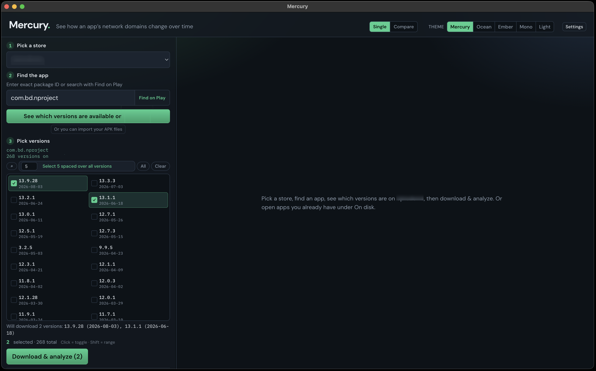

# Mercury Desktop - analyze Android apps over time

**by Elkenson**

<p align="center">
  
</p>

## macOS installation

**macOS beta:** everything required is already bundled into the installable `.dmg` available from Releases. (Not the source code .zip files).

**[Download Mercury Desktop for macOS](https://github.com/elkenson/mercury-desktop-releases/releases/download/v0.1.0-beta.1/Mercury.Desktop-0.1.0-beta-arm64.dmg)**

Releases for macOS are in **Releases** on this repo. 
The builds are not code-signed yet, so a Gatekeeper prompt is expected.

1. Open the DMG and drag Mercury Desktop into Applications.
2. If macOS blocks it ("App is damaged and can't be opened"), paste this in Terminal:

```bash
xattr -cr "/Applications/Mercury Desktop.app" && open "/Applications/Mercury Desktop.app"
```

Windows and Linux versions coming soon.

---

Mercury is an desktop app for analysing and auditing Android packages over time. Pull versions from public repositories (or drop in APK samples you already have), then see a variety of features and how that picture changes release to release with chronological visualisations.

Mercury is built for people who need to audit apps continuously, find new evidence, and get a clear view of an APK's footprint without digging through every version by hand. It’s also meant for people from other disciplines who can complement their work by seeing technical evidence — brought together in one installable package, without having to learn cybersecurity tools day to day.

---

## How Mercury works

1. Search for an app (or enter a package name you already know).
2. Choose versions available from a repository listing, or add your own APK samples to Mercury.
3. Analyze — Mercury scans for a variety of technical traits and indicators
4. Explore the graph, features, and churn tabs, or try the compare panel when you have more than one package.
5. Export if you need something you can share or keep.

Mercury does **not** ship or redistribute APKs. You resolve and download packages yourself (or analyze local samples you already have). Store terms, local law, the samples you choose to analyze (and any associated risks), and how you use this software are your responsibility.

## Features

### Follow an app across versions
Pick an app, select the versions you care about, and see its history unfold. Traits appear in a chronological heatmap. You can look at connectvitiy, permissions, SDKs, and native libraries all in the same way. Cross reference traits with company/operators.

### Match against hints
Mercury ships a tentative list of complementary data and hints for domains, companies, SDKs, native libs. Hints are labeled when something matches so the raw technical signals are easier to understand. This data is a work in progress and is still being verified, so treat matches as leads, not facts without further confirmation.

### Highlight countries
Color heatmaps by curated country hints on matched entities (operator / HQ). Color technical indicators by country when Mercury has a match, country flags and entity labels show on the interactive visualisation.

### Compare apps side by side
Load two or more packages and see what’s shared versus what’s unique between them. Useful when you’re checking related apps rebrands, geotwins, or “same company, different skin” situations. Overlap, outliers, and network graphs help you see the relationships quickly.

### Find what’s actually in the package
Browse strings and classes, check signing certificates, and run through a checklist of known frameworks, packers, SDKs, and native libs. Good for answering a range of questions without opening a dozen tools. Unpacking isn’t supported in Mercury. If you have a packed or otherwise hard sample, reach out to our team through our website - we can help perform bespoke analysis in these cases, including memory forensics and dynamic analysis.

### Work across app frameworks
Coverage of Mercury is expanding beyond plain Java/Kotlin apps. Flutter apps are supported too. Other frameworks (React Native, Capacitor, and similar) are flagged when Mercury recognizes them, and we aim to provide deeper parsing support growing over time.

### Spot churn between releases
See small changes in what was added or removed from one version to the next. When a new domain, permission, or library appears, or disappears, it can be easy to spot in granular churn view.

### Export your findings
Save interactive HTML graphs and offline views so you can share and save your findings. You can also copy the current chart as plain text, formatted for pasting straight into an AI chat.

---

## Notes

Catalog labels (domains, companies, SDKs, permissions, native libs) are a tentative list of attribution hints, and are still undergoing verification. Treat them as a starting point for investigation, not established facts. Always double-check before publishing or sharing results.

Mercury is provided **as-is** for research and education. It is not a store and not legal advice. The authors make **no warranty** of any kind and are **not liable** for damages, data loss, misuse, terms-of-service violations, illegal use, or anything else that comes from running or relying on this tool. You alone are responsible for what you analyze and how you use the results. Use at your own risk.
